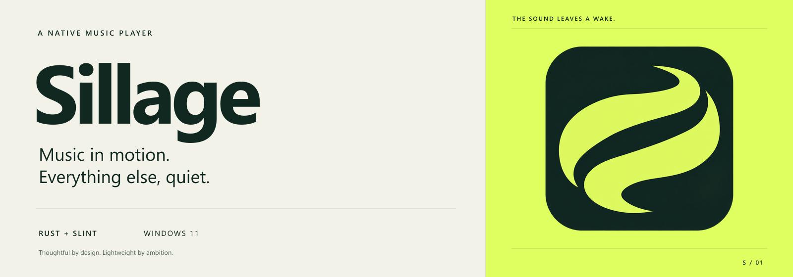

<p align="center">
  
</p>

<p align="center">
  <strong>A thoughtful native home for YouTube Music.</strong><br>
  Built around the music, the moment, and the resources worth keeping free.
</p>

<p align="center">
  <a href="#the-idea">The idea</a> ·
  <a href="#what-were-building">The player</a> ·
  <a href="#under-the-surface">The stack</a> ·
  <a href="#from-first-note-to-first-release">The roadmap</a> ·
  <a href="#follow-the-build">Follow the build</a>
</p>

> [!NOTE]
> **Early development.** Native public search and progressive playback are now
> connected in source: find a track, press Play, and stream it without a local file.
> The development build compiles; this integrated flow still needs runtime validation.
> Earlier standalone public retrieval and silent AAC decoding checks succeeded.
> Browsing, accounts and a packaged public release remain ahead; performance figures
> are engineering targets.

## The idea

Open your music. Find something good. Get on with your day.

Sillage is being designed for that rhythm: a quick entrance, a considered interface,
and long listening sessions with a small footprint. Its name evokes a wake — the
trace left by something in motion. The icon turns that idea into two flowing forms
and a clean channel of negative space.

The application will draw its own interface and decode audio locally. **Rust handles
the work. Slint shapes the experience.** A browser engine is outside the architecture.

The initial target is **Windows 11, x64**. Sillage has its own repository, identity,
and data directory, separate from [UltraMusic](https://github.com/Zvenytoh/UltraMusic).

## What we're building

| A moment | The intended experience |
| :--- | :--- |
| **You open the player.** | A local shell becomes usable while online content loads in the background. |
| **You look for a track.** | Responsive search, album and artist pages, and playlists that load progressively. |
| **You settle into an album.** | Native audio playback, a persistent queue, shuffle, repeat, and seeking where the stream supports it. |
| **You move to something else.** | Media keys and Windows playback controls keep the music within reach. |
| **You tuck the window away.** | Playback continues; hidden artwork and progress indicators stop requesting redraws. |
| **You come back tomorrow.** | Your queue and position return, paused and ready for you. |

Account sign-in and personal library access have their own feasibility milestone.
They will be described as supported only after the actual service flow works.

### A little restraint goes a long way

The visual direction pairs deep pine with a bright citron accent, generous spacing,
readable type, and album artwork given room to breathe. Movement should help you
understand an action, then settle.

Keyboard access, visible focus, high contrast, reduced motion, and useful error states
belong in the first release. Quiet operation matters as much as the first impression.

## Under the surface

| Layer | Decision | Purpose |
| :--- | :--- | :--- |
| Application | **Rust** | Own state, resources, and background work explicitly. |
| Interface | **Slint** | Compile a custom, reactive interface into the application. |
| Graphics | **Winit + FemtoVG** | Start with one rendering path and a focused dependency set. |
| Audio | **Symphonia + rodio** | Decode supported streams and own local audio output. |
| Networking | **ureq** | Run bounded HTTPS work away from the interface thread. |
| Local state | **serde + JSON** | Keep settings and queue recovery versioned and atomically written. |
| Windows | **windows-rs** | Connect media controls, the notification area, and protected session storage. |

This is the selected architecture. Its value will be judged through implementation
and measurement, including codec availability and graphics-driver behavior.

**The boundaries matter:** bounded audio buffers, bounded artwork caches, virtualized
lists, stale-request cancellation, and event-driven updates. Long tracks should not
require keeping the entire audio file in memory.

<details>
<summary><strong>The performance envelope we're aiming for</strong></summary>

<br>

| Measurement | Initial target |
| :--- | :--- |
| Local interface ready, warm launch | P95 ≤ **500 ms** |
| Local interface ready, cold launch | P95 ≤ **1,500 ms** |
| Private process memory after 30 minutes of playback | **≤ 150 MiB** |
| Average CPU during background playback | **≤ 1%** of total CPU capacity |
| Compressed audio buffer | **≤ 8 MiB**, independent of track length |
| Decoded artwork cache | **≤ 32 MiB**, with GPU textures measured separately |

These are proposed budgets, **not benchmark results**. Hardware, codec, bitrate,
display settings, and measurement methodology must accompany any published numbers.
Window startup and time to first sound will be measured separately. CPU usage alone
will not be presented as a battery-life result.

The [design document](docs/superpowers/specs/2026-10-25-sillage-design.md)
contains the full budgets and measurement conditions.

</details>

## From first note to first release

Each milestone has a working deliverable and a condition for moving forward.

| Stage | Deliverable | Status |
| :--- | :--- | :--- |
| **Foundation** | Architecture, roadmap, agent workflow, application artwork | Available in this repository |
| **M0 · Prove the connection** | Establish search, stream access, formats, and account feasibility | Public retrieval and silent decoding checked; output/account work remains |
| **M1 · Make it play** | A native local-file player with a coherent UI and playback state | First implementation; runtime QA pending |
| **M2 · Bring the catalog in** | Public search, browsing, streaming, queue recovery, and Windows controls | Search and progressive playback implemented; integrated runtime QA pending |
| **M3 · Make it personal** | Protected sign-in and the personal library capabilities proven in M0 | Planned |
| **M4 · Make it hold up** | Visual refinement, accessibility, measured performance, installation, and updates | Planned |
| **V1 · Release with evidence** | A documented capability matrix and checks behind every published promise | Planned |

The [full implementation plan](docs/superpowers/plans/2026-10-25-sillage.md)
breaks this into **13 tasks**, with file ownership, interfaces, verification cases,
and release gates. There is no release date yet; service feasibility comes first.

## The service is part of the problem

A native interface does not automatically provide access to every YouTube Music
capability. Internal service behavior can change. Authentication, signed streams,
available codecs, and account features need direct verification.

Sillage will document what it can actually do. Higher-bitrate or Premium playback,
remote likes and playlist editing, and full service parity are not promised.
DRM circumvention, protected offline downloads, and video playback are outside
the initial scope.

Sessions are intended to stay on your machine, protected with Windows DPAPI.
Credentials and signed playback URLs must stay out of logs and Git. Any external
browser used for sign-in will be a deliberate, temporary step initiated by you.

## Follow the build

You can [watch the repository](https://github.com/Zvenytoh/Sillage) for progress
or [open an issue](https://github.com/Zvenytoh/Sillage/issues) with a concrete
listening scenario, accessibility need, or service compatibility concern.

### Build the development preview

Use Windows 11 x64, Rust 1.92 or newer, and a working Windows linker/toolchain.

```powershell
cargo build --locked --release --bin sillage
```

The preview opens on a public YouTube Music search. Search waits for a 200 ms pause
in typing, displays up to 100 distinct tracks, and lets you start a result directly.
Network access and decoding run on background workers; audio arrives in bounded
chunks. Play/Pause, Stop and volume remain available. A native file picker is optional.
Local files open paused; selecting an online result starts playback. Standard builds
write to `target/release/`.

This first connection supports direct public AAC/M4A streams. Album/artist pages,
pagination, artwork, queue management, seeking, automatic network recovery and account
sign-in are still pending. Unsupported tracks report an error with a manual retry.

The [output check](docs/research/audio-output-check.md) and
[M1 record](docs/qa/m1-local-player.md) and
[connected-preview record](docs/qa/public-search-playback.md) distinguish implementation, compilation
and runtime verification. The agent has not launched this preview or used desktop
automation. There is no packaged release yet.

| Read | For |
| :--- | :--- |
| [Design](docs/superpowers/specs/2026-10-25-sillage-design.md) | Product scope, decisions, constraints, and budgets |
| [Implementation plan](docs/superpowers/plans/2026-10-25-sillage.md) | The complete path from feasibility to V1 |
| [Architecture](docs/ARCHITECTURE.md) | Module ownership and data flow |
| [Current state](docs/STATUS.md) | Decisions, actual checks, and the next action |
| [Application icon](docs/APP-ICON.md) | Artwork, exports, and small-size inspection |

Planning documents are currently written in French; this README is the English
entry point.

<details>
<summary><strong>For coding agents and contributors</strong></summary>

<br>

Start with [AGENTS.md](AGENTS.md). It preserves the user's scope and verification
permissions. The repository includes **Ponytail, Caveman, Graphify, and selected
Superpowers skills**, loaded only when relevant.

Small complete changes, targeted file reads, compact command output, and a persistent
handoff keep work focused. Graph output stays local. Tests, desktop control, and
subagents follow the explicit permissions recorded in the repository.

See [tooling and token discipline](docs/TOOLING.md) for provenance and practical rules.

</details>

---

**Acknowledgements.** [TubeFast](https://github.com/yigitbozyaka/tubefast) is a useful
reference for a Rust music client without an embedded browser. Sillage is an
independent project; reused code, if any, must retain its attribution and license.

**Independence and licensing.** Sillage is unofficial and is not affiliated with
Google or YouTube. Their names and trademarks belong to their owners. The application
code is licensed under [MIT](LICENSE). Dependencies and vendored development skills
retain their own licenses; see [third-party notes](THIRD_PARTY.md). The application icon is an AI-generated raster asset;
its source and inspection notes are documented separately.
